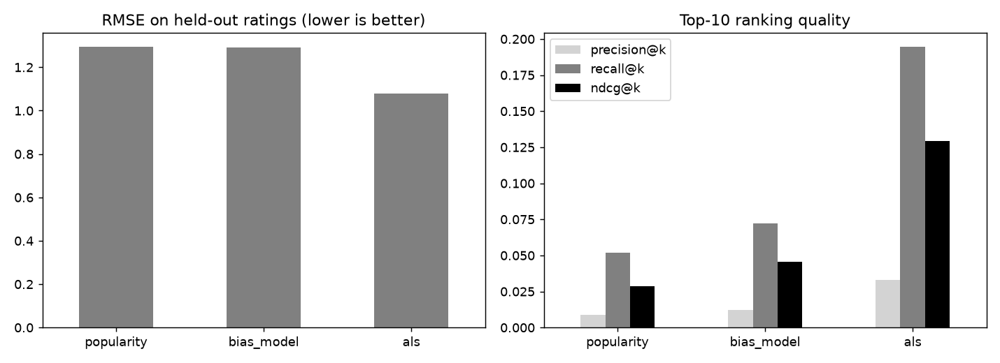

# movie-recommender

Collaborative filtering from scratch: popularity, bias model and ALS matrix factorisation, with ranking metrics.

## Task

Recommend items a user has not seen and evaluate it as a ranking problem, not just by rating error.

## Approach

- Sparse ratings come from a low-rank taste model with user and item biases and uneven popularity.
- Each user keeps a few ratings for testing; the split is per user and has no overlap with training.
- Models: damped item average, user and item biases with shrinkage, and ALS on the residuals of the bias model (implemented with numpy linear solves).
- Metrics: RMSE on held-out ratings, and precision, recall and NDCG at 10 for items rated 4 or higher, excluding items already seen.

## Results



- 1,500 users, 400 items, 19,449 ratings, sparsity 96.8%.
- RMSE: popularity 1.293, bias_model 1.290, als 1.077.
- NDCG@10: popularity 0.029, bias_model 0.045, als 0.129.
- Recall@10 for ALS is 0.194 against 0.052 for popularity.

## Run

```bash
pip install -r requirements.txt
python run.py      # generates data, runs the analysis, writes reports/
pytest             # unit tests
```

## Layout

```
src/data.py     data generation (fixed seed, no downloads)
src/core.py     analysis / model code
run.py          end-to-end script
tests/          unit tests
reports/        figures and summary.json produced by run.py
```

## Notes

The data is generated by `src/data.py` with a fixed random seed, so the numbers above are reproducible. It is synthetic: it is meant to show the method, and results on real data will differ.

Stack: numpy, pandas, scipy, matplotlib.
